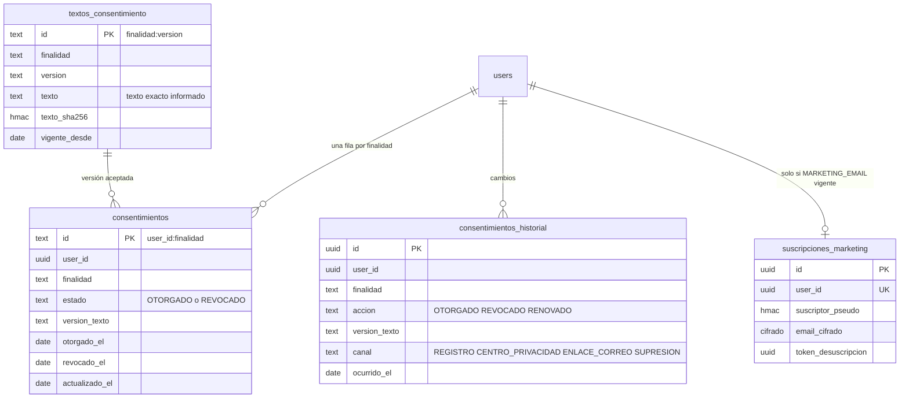
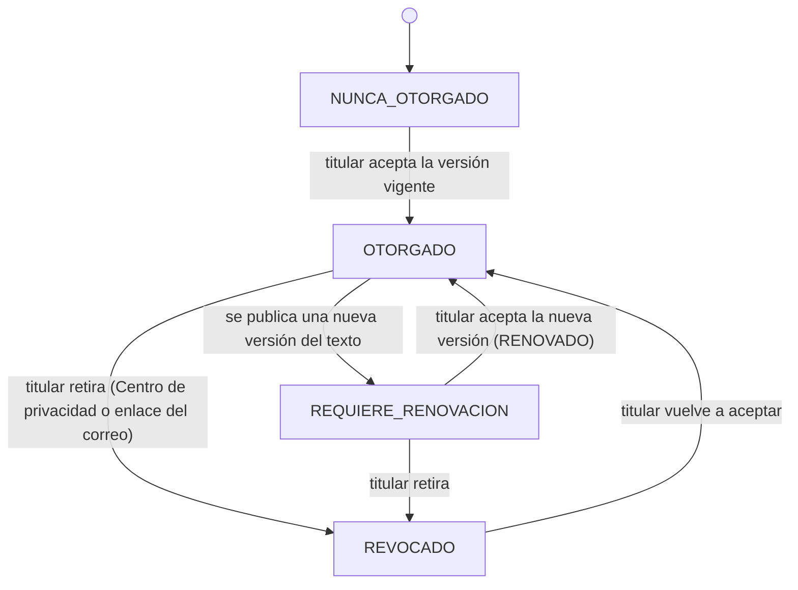
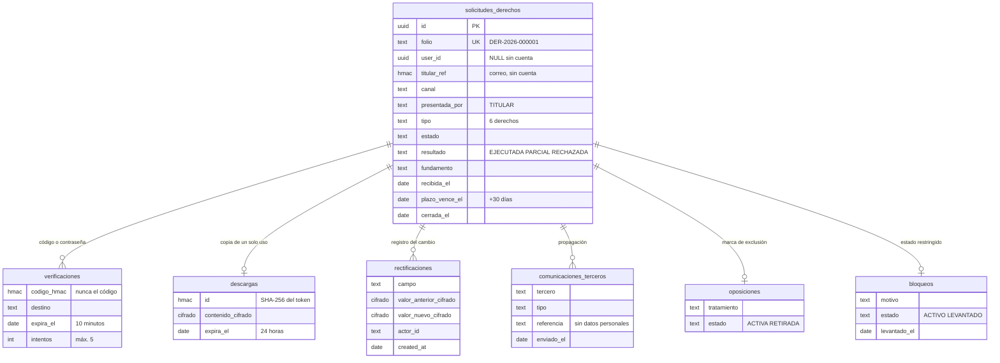
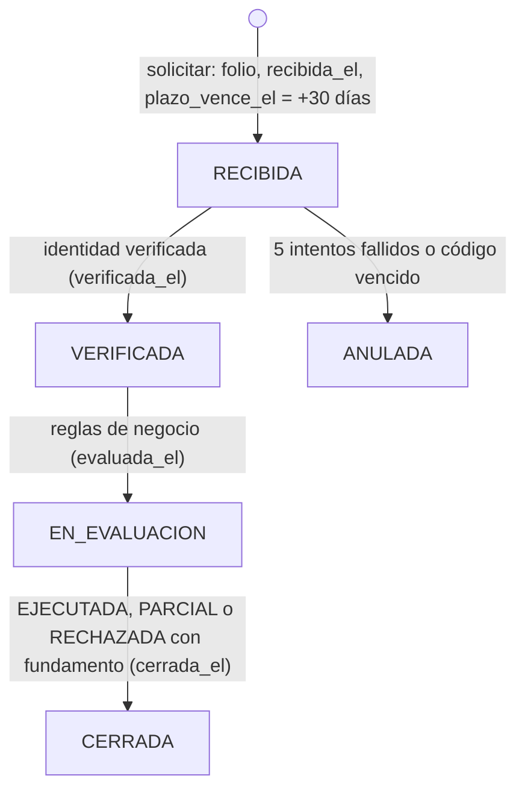

# Informe técnico — Consentimiento, derechos de los titulares, auditoría y respuesta a incidentes en NortiShop

**Caso:** Plataforma de comercio electrónico NortiShop
**Integrantes:** Catalina Toledo · María Gerónimo · Pablo Lineros · Fabián Salinas
**Código fuente:** carpeta `ITEM2/` y scripts SQL `00` a `04` de este repositorio
**Plan de respuesta a incidentes:** documento aparte, `PLAN_RESPUESTA_INCIDENTES.md`

---

## 1. Introducción

En los hitos anteriores, NortiShop pasó a cifrar sus datos personales, minimizar su base de datos, seudonimizar lo que comparte y aplicar RBAC con mínimo privilegio. Quedaban pendientes cuatro capacidades que la Ley 21.719 exige demostrar (vigente desde el 1 de diciembre de 2026):

1. Gestionar el **consentimiento** por finalidad, con prueba y revocación efectiva.
2. Atender los **derechos de los titulares** (acceso, portabilidad, rectificación y supresión) con verificación de identidad.
3. Mantener un **registro de auditoría** que permita reconstruir lo ocurrido sin convertirse en otro depósito de datos personales.
4. **Responder a incidentes** con roles, criterios y plazos definidos.

Todo está implementado en el código, integrado con los módulos existentes y verificado con **93 pruebas automatizadas**. Se puede usar desde una pantalla web (Centro de privacidad), desde la API HTTP o desde la demo por consola.

| Entregable | Dónde está |
|---|---|
| Diseño del módulo de consentimiento | §2 de este informe y `04_consentimiento_derechos_auditoria.sql` (§4.2) |
| Documento de ejercicio de derechos | §3 (incluye la correspondencia con la actividad PR-05) y `05_ejercicio_derechos.sql` |
| Diseño del registro de auditoría | §4 |
| Plan de respuesta a incidentes | `PLAN_RESPUESTA_INCIDENTES.md` (resumen en §5) |
| Código fuente actualizado | `ITEM2/src/` (§6) |
| Evidencias de pruebas | §7, `ITEM2/test/` y `ITEM2/evidencias/` |
| Justificación técnica final | §8 |

---

## 2. Módulo de gestión del consentimiento

### 2.1 Finalidades y bases de licitud

El primer paso fue separar los tratamientos que **dependen** del consentimiento de los que tienen **otra base**. Pedir consentimiento para lo que no lo requiere es engañoso: hace creer al titular que puede negarse a algo necesario para el contrato. El catálogo está en `src/config/finalidades.js`.

| Finalidad | Base de licitud | ¿Se pide consentimiento? |
|---|---|---|
| `MARKETING_EMAIL`: ofertas y novedades por correo | Consentimiento | Sí |
| `GUARDAR_MEDIO_PAGO`: conservar el token de la tarjeta | Consentimiento | Sí |
| `ANALITICA_COMPRAS`: historial seudonimizado en análisis de negocio | Consentimiento | Sí |
| Gestión de la cuenta y de las compras | Ejecución del contrato | No (se informa) |
| Despacho de pedidos | Ejecución del contrato | No (se informa) |
| Boletas y facturas | Obligación legal | No (se informa) |
| NortiPuntos | Ejecución del contrato (condiciones del programa) | No (se informa) |
| Seguridad, auditoría y prevención de fraude | Interés legítimo | No (se informa) |

### 2.2 Modelo de datos

Cómo se cumple cada requisito del enunciado:
- **Fecha y hora, finalidad, versión y estado:** columnas `otorgado_el` / `revocado_el`, `finalidad`, `version_texto` y `estado`.
- **Historial consultable:** `consentimientos_historial`, que solo admite inserciones. Ningún rol de BD tiene `UPDATE` ni `DELETE` sobre ella.
- **Fecha y hora de la revocación:** `revocado_el` y la fila `REVOCADO` del historial.
- **Versionado del texto:** `textos_consentimiento` guarda cada versión con su SHA-256, como prueba de qué se mostró.

### 2.3 Estados y versiones

- `REQUIERE_RENOVACION` es un estado **calculado**: el consentimiento está otorgado, pero sobre una versión anterior a la vigente. **No habilita** el tratamiento. Por ejemplo, la exportación de marketing deja de incluir a ese titular.
- Al aceptar, el cliente envía la **versión que vio**. Si el texto cambió entretanto, la respuesta es `CONFLICTO`: nadie queda consintiendo un texto que no leyó.
- Solo el **Oficial de Privacidad** publica versiones nuevas (`consentimiento:textos:publicar`).

### 2.4 Revocación y su efecto en los procesos

La revocación es inmediata y sin efecto retroactivo: no deshace lo que se hizo legítimamente antes. Cada finalidad define qué ocurre en los procesos que dependen de ella (`EFECTOS` en `consentService.js`):

| Finalidad revocada | Efecto inmediato | Cómo se evita su uso posterior |
|---|---|---|
| `MARKETING_EMAIL` | Se **elimina** la fila de la lista de envío y la equivalencia del seudónimo de marketing. | La vista `v_export_marketing` exige, además, consentimiento `OTORGADO` sobre la versión vigente (defensa en profundidad). |
| `GUARDAR_MEDIO_PAGO` | El token se **invalida en la pasarela**; NortiShop borra los últimos 4 dígitos y la marca. | `crearPedido` solo usa el token guardado si el consentimiento está vigente; si no, pide la tarjeta para un pago único que no se guarda. |
| `ANALITICA_COMPRAS` | Se **borran sus filas** del esquema `analitica` y la equivalencia del seudónimo. | El ETL solo incluye a titulares con consentimiento vigente y sin lápida de supresión. |

### 2.5 Un consentimiento no habilita otras finalidades

- **Una fila por (titular, finalidad).** No existe un "aceptar todo" ni un consentimiento global.
- **En el registro, una casilla por finalidad**, desmarcada por defecto. Solo cuenta el booleano `true`: el texto `"true"` no se acepta como consentimiento (está probado).
- **Cada proceso consulta su propia finalidad.** El ETL pregunta por `ANALITICA_COMPRAS`, la exportación por `MARKETING_EMAIL` y el cobro por `GUARDAR_MEDIO_PAGO`. Ningún proceso deduce un permiso a partir de otro.
- **Revocar uno no toca los demás.** Está probado que, al revocar marketing, el medio de pago y la analítica siguen otorgados.
- **Las finalidades con otra base no se pueden "consentir".** Si alguien intenta otorgar `CUENTA_Y_COMPRAS`, la respuesta es `DATO_INVALIDO`.

### 2.6 Trazabilidad sin datos innecesarios

El historial guarda lo justo para **probar** el consentimiento: quién (id interno), qué finalidad, qué versión, qué acción, por qué canal y cuándo.

**No** guarda IP, navegador, ubicación, nombre, correo ni el texto completo, porque el texto se reconstruye con la versión. Tampoco se registra ninguna huella del dispositivo: probar el consentimiento no la necesita, y guardarla agregaría otro dato personal por cada clic.

### 2.7 Menores de edad

**El flujo diferenciado no aplica a NortiShop, y el sistema impide que se use con menores.** Las razones:

1. **Capacidad para contratar:** comprar en línea y pagar con tarjeta son actos que requieren capacidad legal. NortiShop no ofrece productos ni servicios dirigidos a niños, niñas o adolescentes.
2. **Mayor protección legal:** la Ley 21.719 exige un tratamiento reforzado de los datos de niños, niñas y adolescentes (autorización de padres o representantes, interés superior del niño). Gestionarlo exigiría verificar la edad y la representación legal, es decir, recolectar más datos de los que la finalidad justifica.
3. **Implementación:** el registro exige `declaraMayorDeEdad: true`. Se guarda solo **la fecha de la declaración** (`mayor_edad_declarado_el`), nunca la fecha de nacimiento: el servidor rechaza `fecha_nacimiento` como campo no permitido. Si se detecta una cuenta de un menor (por ejemplo, por un reclamo), SEGURIDAD deshabilita las sesiones y el DPO ejecuta la supresión.

Si en el futuro NortiShop vendiera a menores, el flujo diferenciado sería:
- Declaración del rango de edad.
- Para menores de 14 años, consentimiento del representante legal verificado: correo del representante, más un cargo de verificación de $0 con su medio de pago.
- Finalidades de marketing y analítica bloqueadas para menores.
- Tablas `representantes` y `verificaciones_representante`, con su propia trazabilidad.

### 2.8 Pantallas e interfaces

**Centro de privacidad** (`ITEM2/public/`, `npm run servidor` y abrir `http://127.0.0.1:3000/`):
- Una tarjeta por finalidad con el texto vigente, la versión, un chip de estado (Aceptado, Retirado, No aceptado o Texto actualizado), las fechas y los procesos que dependen de ella, más el botón de aceptar o retirar.
- La lista de usos que no dependen del consentimiento, con su base legal.
- La tabla del historial de consentimientos.
- Las cuatro acciones de derechos, el formulario de verificación, el resultado con descarga del JSON y la tabla de solicitudes.
- Una bandeja de correo **simulada**, donde llega el código de verificación.

**API HTTP** (`POST /api/<grupo>/<operación>`, token en `Authorization: Bearer`):

| Operación | Ruta |
|---|---|
| Consultar estado | `consentimiento/estado` |
| Otorgar | `consentimiento/otorgar` |
| Revocar | `consentimiento/revocar` |
| Historial | `consentimiento/historial` |
| Baja desde el correo (sin sesión) | `consentimiento/desuscribir` |
| Publicar versión (solo OFICIAL_PRIVACIDAD) | `consentimiento/publicarVersion` |

> *Capturas sugeridas:* la pantalla del Centro de privacidad antes y después de retirar un consentimiento, y la tabla del historial.

---

## 3. Ejercicio de derechos

NortiShop implementa los seis derechos de la sesión "Mecanismos técnicos para el ejercicio de derechos" (PR-05): acceso, portabilidad, rectificación, supresión, oposición y bloqueo. Cada uno es un flujo con verificación, reglas de negocio, constancia y respuesta al titular; ninguno es un botón sin validaciones.

**Correspondencia con la actividad PR-05:**

| Punto de la actividad | Implementación | Prueba (`ITEM2/test/`) |
|---|---|---|
| 1. Canal de solicitudes y modelo de datos | Dos canales (Centro de privacidad y formulario sin cuenta); `solicitudes_derechos` con folio, estado, fechas por etapa y fecha límite (§3.1) | `ejercicio_derechos.test.js` → 1 |
| 2. Verificación de identidad antes de atender | Contraseña y código según el riesgo; código al correo informado en el canal sin cuenta (§3.2) | `ejercicio_derechos.test.js` → 2 y 2b |
| 3. Acceso y portabilidad: todos los datos del titular y solo los suyos | Mapa de datos por titular; JSON con origen, finalidad, destinatarios y plazos; enlace de descarga temporal, de un solo uso y cifrado (§3.3 y §3.4) | `derechos.test.js` → Acceso, Portabilidad; `ejercicio_derechos.test.js` → 3 |
| 4. Rectificación con registro del cambio | Tabla `rectificaciones`: valor anterior y nuevo (cifrados), quién y cuándo; aviso a terceros (§3.5) | `ejercicio_derechos.test.js` → 4 |
| 5. Supresión: qué se elimina, qué se bloquea y cómo se propaga | Eliminación efectiva, bloqueo legal con fecha de término, propagación a copias, respaldos y terceros (§3.6) | `ejercicio_derechos.test.js` → 5 y 5b |
| 6. Oposición o bloqueo de al menos un tratamiento | Ambos: oposición a la encuesta de satisfacción y bloqueo del tratamiento (§3.7) | `ejercicio_derechos.test.js` → 6a y 6b |
| 7. Prueba con solicitud concreta, incluida una no verificada | Una prueba por mecanismo y un caso no verificado para cada uno de los seis derechos | `ejercicio_derechos.test.js` → 2 |

**Checklist de la actividad:**

| Pregunta | Respuesta |
|---|---|
| ¿Cada solicitud queda registrada, con su estado, su fecha límite y su resultado? | Sí: folio, estado, una fecha por etapa, `plazo_vence_el` y resultado (`EJECUTADA`, `PARCIAL` o `RECHAZADA`) con fundamento. |
| ¿Se verifica la identidad antes de entregar o modificar datos? | Sí, en los dos canales. Una solicitud no verificada no produce ningún efecto (probado para los seis derechos). |
| ¿La exportación incluye los datos de todas las fuentes y excluye los de otras personas? | Sí: 19 ubicaciones posibles más los terceros, sin datos de otros titulares (probado). |
| ¿La rectificación guarda el valor anterior, el nuevo, quién lo cambió y cuándo? | Sí, cifrados en `rectificaciones`. El titular los ve en su copia de acceso. |
| ¿La supresión alcanza a copias, respaldos y terceros, o está justificado por qué no? | Sí: copias exportadas borradas, respaldos con rotación de 35 días y reaplicación por lápida, y aviso a la pasarela y a la plataforma de correo con constancia. |
| ¿Cuando se conserva un dato por obligación legal, se bloquea y se informa el motivo? | Sí: la facturación queda bloqueada hasta 6 años después de su emisión, el titular recibe el motivo y la fecha, y un proceso la elimina al cumplirse el plazo. |

### 3.1 Canal de solicitudes y modelo de datos

| Canal | Para quién | Derechos | Cómo se encuentra |
|---|---|---|---|
| Centro de privacidad | Titulares con cuenta | Los seis | Sección "Tus derechos" de la cuenta |
| Formulario sin cuenta | Quien compró como invitado o ya no tiene cuenta | Acceso y supresión | En la página de inicio del Centro de privacidad, sin iniciar sesión |

Ambos canales son gratuitos, permiten indicar el derecho y los datos (campos a rectificar, tratamiento al que se opone o motivo del bloqueo) y entregan al instante un **folio de seguimiento** (`DER-2026-000001`).

- Cada transición queda con su fecha en `solicitudes_derechos` y con un evento de auditoría (`derechos:<tipo>:recibida`, `verificada`, `ejecutada`, `parcial`, `rechazada`, `anulada`, `descargada`).
- **PARCIAL** significa que se atendió lo que correspondía y algo se conserva por una obligación legal; el fundamento dice qué y hasta cuándo.
- Solo puede haber **una solicitud abierta por tipo** para el mismo titular.
- **Representantes** (padres de un menor o un mandatario): `presentada_por` registra quién presenta la solicitud. Hoy solo se admite al titular; las solicitudes por representante las atiende el Oficial de Privacidad de forma manual, verificando la identidad del representante y la existencia de la representación. NortiShop no tiene cuentas de menores (§2.7).

### 3.2 Verificación de identidad proporcional al riesgo

No se pide **ningún dato adicional**: ni RUT, ni foto del carnet, ni preguntas personales. Se usa lo que el titular ya tiene:

| Solicitud | Riesgo si la pide otra persona | Verificación |
|---|---|---|
| Rectificación de nombre, teléfono o dirección | Medio | Sesión + contraseña |
| Oposición y bloqueo | Medio (restringen el tratamiento) | Sesión + contraseña |
| Rectificación del **correo** | Alto: permite tomar la cuenta | Sesión + contraseña + **código al correo nuevo** + aviso al correo actual |
| Acceso y portabilidad | Alto: entrega todos los datos | Sesión + contraseña + **código al correo registrado** |
| Supresión | Alto e irreversible | Sesión + contraseña + **código al correo registrado** |
| Sin cuenta (acceso y supresión) | Alto | **Código al correo informado**: es el dato que el sistema ya tiene del pedido. Si el correo pertenece a una cuenta activa, se rechaza y se pide usar el Centro de privacidad, que exige además la contraseña. |

Detalles del código:
- Tiene 6 dígitos (`crypto.randomInt`) y vence en 10 minutos.
- Se guarda solo su `HMAC(K_verificacion, solicitud:código)`, nunca el código en claro.
- Con 5 intentos fallidos, la solicitud queda **ANULADA**.
- El mensaje de error no distingue si falló la contraseña o el código.
- En el canal sin cuenta, la respuesta inicial es la misma exista o no información asociada al correo; solo después de verificarlo se informa si hay datos.

### 3.3 Localizar los datos de un titular

`localizarDatosTitular` recorre todas las tablas que guardan datos de la persona, usando su identificador único (`user_id`) o, para los datos seudonimizados, su seudónimo. Además lista los terceros que los recibieron:

| Dónde | Cómo se encuentra |
|---|---|
| Cuenta, pedidos, productos, envíos, facturación, puntos, consentimientos, solicitudes, rectificaciones, oposiciones, bloqueos, descargas pendientes, sesiones | Por `user_id` (o por los pedidos del titular) |
| Reseñas y análisis de compras | Por su seudónimo (HMAC con la llave de cada finalidad) |
| Tabla de equivalencias de seudónimos | Por `user_id` |
| Pasarela de pago, plataforma de correo, operador logístico | Según tenga token guardado, suscripción o pedidos |
| Pedidos como invitado (sin cuenta) | Por el índice ciego del correo (`orders_invitado.email_hmac`) |

El Oficial de Privacidad puede consultar este mapa (`derechos/localizar`) sin ver el contenido de los datos. El titular lo recibe, con nombres comprensibles, en su copia de acceso.

### 3.4 Acceso y portabilidad

**Entrega segura:**
1. La copia se genera con los datos vigentes al ejecutar la solicitud.
2. Se guarda **cifrada** (AES-256-GCM) en `descargas`, y el titular recibe un **enlace con token** de 256 bits.
3. El enlace vence en **24 horas** y es de **un solo uso**: al descargarse, la copia se borra. Solo se guarda el SHA-256 del token.
4. Para titulares con cuenta, la descarga exige además su sesión: otro cliente con el mismo token recibe `ACCESO_DENEGADO`.

**Formato:** JSON (`nortishop.export.v1`), estructurado y legible por máquinas.

| Sección | Acceso | Portabilidad |
|---|:---:|:---:|
| Datos personales (nombre, correo, teléfono, dirección, comuna, declaración de edad, medio de pago: marca y últimos 4 dígitos) | ✅ | ✅ |
| Pedidos (fecha, estado, estado del envío, total, documento, dirección, productos) | ✅ | ✅ |
| Datos de facturación, NortiPuntos y reseñas propias | ✅ | ✅ |
| **Origen y finalidad** de cada grupo de datos | ✅ | ✅ |
| Historial de consentimientos, rectificaciones (valor anterior y nuevo), oposiciones, bloqueos y solicitudes | ✅ | — |
| Información del tratamiento: finalidades y bases, **dónde se encontraron sus datos**, **destinatarios**, plazos de conservación y contacto | ✅ | — |

El origen distingue lo **entregado por el titular**, lo **generado por NortiShop** (estados, puntos) y lo **recibido de la pasarela de pago** (marca y últimos 4 dígitos).

**Se excluye**, por ser información interna o de seguridad: hash de contraseña, índice ciego, token de pago, seudónimos, ids de transacción y autorización, referencias de envío y registros de auditoría. Tampoco se incluyen **datos de otras personas**: está probado que la copia de Ana no contiene datos de Bruno, y que la de una invitada solo trae sus propios pedidos.

### 3.5 Rectificación

- **Validación antes de aceptar la solicitud**, con las mismas reglas del sistema. Una solicitud con datos inválidos no se registra, y un campo no rectificable (por ejemplo `rut`) se rechaza con `CAMPO_NO_PERMITIDO`.
- **Registro del cambio** en `rectificaciones`: campo, **valor anterior**, **valor nuevo**, quién lo hizo y cuándo. Los dos valores van **cifrados** con su propio contexto, porque son datos personales. La auditoría registra solo el nombre del campo.
- **Se aplica en todas las copias del sistema:**
  - Dirección y comuna: también en los pedidos aún no despachados. Los despachados conservan la dirección realmente usada.
  - Correo: índice ciego del login y lista de envío de marketing.
  - Nombre y teléfono: solo el perfil, porque las etiquetas se generan bajo demanda.
  - Documentos tributarios emitidos: no se alteran (se explica en el fundamento).
- **Comunicación a terceros** que habían recibido el dato, con constancia en `comunicaciones_terceros` (solo referencias internas): el operador logístico para un envío pendiente, por su `ref_envio`, y la plataforma de correo si cambió el correo de un suscriptor.
- Si los datos estaban **bloqueados por exactitud en disputa**, la rectificación resuelve la causa y **levanta el bloqueo**.
- Los valores propuestos esperan la verificación cifrados en `cambios_cifrados` y se borran al ejecutar.

### 3.6 Supresión

**Condiciones:** se ejecuta si no hay pedidos en curso; si los hay, se **rechaza con fundamento** (*"sus datos son necesarios para cumplir el contrato; podrá solicitarla cuando finalicen"*).

**Qué se elimina, qué se bloquea y hasta cuándo:**

| Dato | Tratamiento | Fundamento |
|---|---|---|
| Cuenta, contacto, dirección, puntos, sesiones, suscripción, token de pago | **Eliminados** (borrado físico, no lógico) | Sin base para conservar |
| Copias exportadas pendientes, rectificaciones, oposiciones y bloqueos | **Eliminados** | Contienen datos personales |
| Filas analíticas y equivalencias de seudónimos | **Eliminadas**; las reseñas quedan sin poder atribuirse | Sin base |
| Dirección dentro de los pedidos | `NULL` | Ya no es necesaria |
| Pedidos (monto, estado, fecha) | Conservados **sin datos de contacto** | Obligación tributaria |
| Facturación | **Bloqueada** con `bloqueado_hasta` = emisión + **6 años** (Código Tributario, art. 17). Un proceso la **elimina** al cumplirse el plazo. | Obligación tributaria |
| Consentimientos | Revocados con canal `SUPRESION`; el historial queda como prueba, sin datos personales | Responsabilidad demostrada |
| Solicitud de supresión | Conservada (folio, tipo, fechas, resultado) | Prueba de que se atendió el derecho |

Cuando algo se conserva por ley, el resultado es **PARCIAL** y el titular recibe el motivo y la fecha hasta la que se conservará.

**Propagación:**
- **Copias:** se borran las descargas pendientes; un enlace ya entregado deja de funcionar.
- **Respaldos:** se sobrescriben en un máximo de **35 días**. Si se restaura uno anterior, `reaplicarSupresiones` reconoce a los titulares suprimidos por su **lápida** (`HMAC(K_indice, 'supresion:' + user_id)`, sin datos personales) y los vuelve a eliminar antes de reabrir el servicio.
- **Procesos:** el ETL excluye a quien tiene lápida, así que los datos suprimidos no vuelven a usarse.
- **Terceros:** se revoca el token en la **pasarela de pago** y se da de baja al suscriptor en la **plataforma de correo**, con constancia en `comunicaciones_terceros`.
- **Auditoría:** no contiene datos personales, así que no requiere borrado.

**Sin cuenta:** la invitada verificada puede pedir la supresión de su contacto. Se borran nombre, correo, teléfono, dirección y el índice ciego del correo en sus pedidos; se conservan monto, estado y fecha (resultado `PARCIAL`).

### 3.7 Oposición y bloqueo

**Oposición** (`oposiciones`): marca de exclusión por tratamiento, que el sistema consulta **antes** de ejecutarlo. El tratamiento oponible implementado es la **encuesta de satisfacción** que se envía por correo al entregar un pedido. Su base es el **interés legítimo**, no el consentimiento: por eso el derecho que corresponde es la oposición y no la revocación. Con la oposición activa, la encuesta no se envía y la auditoría registra `tratamiento:encuesta_satisfaccion` como `DENEGADO` con motivo `OPOSICION_ACTIVA`. El resto del servicio no cambia (probado: el marketing consentido sigue funcionando). El titular puede retirar la oposición.

**Bloqueo** (`bloqueos`): estado **restringido**. Los datos se conservan, pero no se usan salvo para lo estrictamente necesario (cumplir pedidos en curso, obligaciones legales y atender al titular). Mientras está activo, el titular queda fuera de:
- La exportación de marketing (la vista lo excluye aunque tenga consentimiento).
- El ETL de analítica.
- Las encuestas.

Además se avisa a la plataforma de correo que suspenda al suscriptor. Motivos: `EXACTITUD_EN_DISPUTA` o `VIGENCIA_DUDOSA`. El bloqueo **se levanta cuando desaparece su causa**: automáticamente al rectificar los datos (si el motivo era la exactitud) o a pedido del titular.

### 3.8 Plazos y respuesta

- La **fecha límite** se calcula y se guarda al recibir la solicitud: 30 días corridos (Ley 21.719, prorrogable una vez).
- El seguimiento del Oficial de Privacidad (`derechos/gestion`) muestra los **días restantes** y marca las solicitudes **por vencer** (5 días o menos) y **vencidas**.
- Un proceso diario (`derechos/revisarPlazos`) **avisa por correo al equipo de privacidad** con los folios por vencer o vencidos.
- El titular recibe siempre una **respuesta clara** en el campo `fundamento`. Si se rechaza o se atiende en parte, se indica el motivo.

### 3.9 Controles de autorización

Cada operación:
1. Exige sesión válida y el permiso `derechos:propios:solicitar` **sobre su propio id** (canal con cuenta), o la verificación del correo (canal sin cuenta). Un cliente que actúa sobre otro titular recibe `ACCESO_DENEGADO`.
2. Valida los campos permitidos según el tipo (`soloCampos`): por ejemplo, una oposición no acepta `cambios`.
3. Verifica la identidad antes de producir cualquier efecto.
4. Aplica las reglas de negocio y responde con fundamento.
5. Audita cada transición.

El seguimiento de todas las solicitudes, el mapa de datos de un titular y la revisión de plazos son exclusivos del **OFICIAL_PRIVACIDAD**, y no muestran datos personales.

---

## 4. Registro de auditoría

### 4.1 Eventos registrados

| Categoría | Eventos |
|---|---|
| `AUTENTICACION` | Inicio de sesión exitoso y fallido (la cuenta se identifica por el prefijo del índice ciego), y cuenta bloqueada |
| `CONSENTIMIENTO` | Otorgado, revocado, renovado y nueva versión de texto publicada |
| `DERECHOS` | Recepción, verificación (incluidos los intentos fallidos), rechazo y anulación de solicitudes |
| `EXPORTACION` | Acceso y portabilidad ejecutados, exportación de marketing y copia de desarrollo |
| `MODIFICACION` | Rectificación ejecutada y edición del perfil (solo nombres de campos) |
| `SUPRESION` | Supresión ejecutada |
| `ACCESO_SENSIBLE` | Revelación de datos completos por soporte, etiqueta de despacho y reversión de seudónimos |
| `ADMINISTRACION` | Gestión de personal y roles, catálogo y pedidos |
| `PROCESO_PRIVACIDAD` | ETL, anonimización de invitados, reaplicación de supresiones y eliminación de datos bloqueados al vencer su plazo legal |
| `TRATAMIENTO` | Ejecución u omisión de un tratamiento oponible (encuesta de satisfacción), con el motivo si se omitió por oposición o bloqueo |
| `SEGURIDAD` | Alertas, integridad de NortiPuntos, fases de incidentes, contención y recuperación |
| `AUDITORIA` | Consultas, verificaciones y purgas de la propia auditoría |
| `CONTROL_ACCESO` | Toda denegación (`ROL_SIN_PERMISO`, `RECURSO_AJENO`, `ROL_SUSPENDIDO_POR_INCIDENTE`, `AUTO_MODIFICACION`) |

### 4.2 Atributos de cada registro

| Atributo | Contenido |
|---|---|
| `secuencia` | Número consecutivo; lo asigna la base de datos |
| `id` | UUID del evento |
| `created_at` | Fecha y hora (ISO 8601, UTC) |
| `actor_id` | Id interno, `sistema`, o `cuenta:<prefijo índice ciego>` si no hay sesión |
| `actor_rol` | Rol en el momento del evento |
| `accion` y `categoria` | Operación realizada y su categoría |
| `recurso` | `tipo:id` del recurso afectado, sin contenido |
| `resultado` | `PERMITIDO`, `DENEGADO`, `EXITO` o `FALLIDO` |
| `motivo` | Contexto acotado (por ejemplo `campos=telefono`, `ticket TCK-1001`), redactado automáticamente |
| `hash_previo` y `hash` | Sello encadenado `HMAC(K_auditoria, hash_previo + contenido)` |

### 4.3 Información que NO se registra

- **Secretos:**
  - Contraseñas: ni las correctas ni las intentadas.
  - Hashes de contraseña.
  - Tokens de sesión y de pago.
  - Códigos de verificación.
  - Llaves criptográficas.
  - Criptogramas.
- **Contenido de datos personales:**
  - Nombres, correos, teléfonos y direcciones.
  - Valores rectificados, anteriores o nuevos.
  - El contenido de las copias de acceso o portabilidad.
- **Datos técnicos de rastreo:** IP o navegador. No se necesitan para las finalidades definidas, y su ausencia es una decisión de minimización (ver §8).

Hay dos capas de protección: los servicios solo envían ids y nombres de campos, y además `registrarAuditoria` pasa `recurso` y `motivo` por la **redacción automática**, que reemplaza correos, números de tarjeta, tokens, hashes y criptogramas. Una prueba recorre un flujo completo y busca en la auditoría contraseñas, correos, nombres, direcciones, teléfonos, tokens y hashes, sin encontrar ninguno.

### 4.4 Protección contra modificación, acceso no autorizado y eliminación

| Amenaza | Control |
|---|---|
| Lectura por la aplicación o por roles no autorizados | `svc_app` solo tiene `INSERT` sobre `audit_log`. Solo `rol_auditor` tiene `SELECT`. En la aplicación, solo ADMINISTRADOR, OFICIAL_PRIVACIDAD y SEGURIDAD tienen `auditoria:leer`, y cada consulta queda a su vez auditada. |
| Modificación | Ningún rol tiene `UPDATE`. Si alguien la altera directamente en la base, el sello de esa fila deja de coincidir y `verificarCadena` la detecta y genera la alerta `INTEGRIDAD_COMPROMETIDA` (crítica). |
| Eliminación de un registro intermedio | Solo `svc_retencion` tiene `DELETE`. Un borrado directo deja un salto de secuencia y rompe la cadena: se detecta. |
| Truncamiento del final | Las **anclas** (cabeza de la cadena) se guardan en una tabla de solo inserción, que en producción sería un almacenamiento WORM. Si faltan registros posteriores a un ancla, se detecta. |
| Falsificar la secuencia o el sello al insertar | El **disparador** de la base asigna la secuencia y calcula el sello, ignorando lo que envíe quien inserta (probado). |

### 4.5 Quién consulta y con qué permisos

| Rol | Puede |
|---|---|
| ADMINISTRADOR | Consultar con filtros (categoría, actor, acción, resultado, fechas) y verificar la cadena |
| OFICIAL_PRIVACIDAD | Consultar y verificar; **purgar** por retención (`auditoria:retencion`) |
| SEGURIDAD | Consultar y verificar; preservar los eventos como evidencia de un incidente |
| Cualquier otro rol | Nada: `ACCESO_DENEGADO`, y la denegación queda auditada |

### 4.6 Conservación y eliminación segura

- **Plazo: 24 meses.** Cubre la investigación de incidentes y los reclamos (el plazo de respuesta a derechos y las prescripciones habituales), sin conservar indefinidamente.
- **Purga** (`purgarVencidos`, OFICIAL_PRIVACIDAD, mediante `svc_retencion`):
  1. Exige que la cadena esté **íntegra** antes de borrar, para no destruir la evidencia de una manipulación.
  2. Borra solo el **tramo inicial contiguo** vencido. Nunca borra la cabeza de la cadena.
  3. Deja constancia en `auditoria_purgas` (hasta qué secuencia y con qué hash), de modo que la cadena restante sigue siendo verificable.
  4. Audita la propia purga.
- **Evidencia de incidentes:** si un período está bajo investigación, sus eventos ya fueron copiados a `evidencias` con su SHA-256, así que la purga no los destruye.

### 4.7 Equilibrio entre trazabilidad, investigación y minimización

- Con ids internos, el recurso y la secuencia se puede **reconstruir quién hizo qué y cuándo**, y cruzarlo con las tablas operativas solo si hace falta y por quien tiene permiso.
- Prescindir del contenido evita que la auditoría se convierta en una **segunda base de datos personales** con una retención más larga que la original. Una filtración de la auditoría no expone a los clientes.
- Para la **investigación de incidentes**, la cadena sellada y las anclas permiten afirmar que lo registrado no fue alterado, algo que un log de texto plano no garantiza.

### 4.8 Ejemplo de eventos reales (salida de `npm run demo:privacidad`)

| sec | categoría | acción | rol | recurso | resultado | motivo |
|---|---|---|---|---|---|---|
| 33 | EXPORTACION | `derechos:acceso:ejecutada` | CLIENTE | `solicitud:3763bdae-…` | EXITO | `formato=nortishop.export.v1; pedidos=1` |
| 34 | DERECHOS | `derechos:rectificacion:recibida` | CLIENTE | `solicitud:69e4065d-…` | EXITO | `campos=direccionDespacho,comuna` |
| 36 | MODIFICACION | `derechos:rectificacion:ejecutada` | CLIENTE | `solicitud:69e4065d-…` | EXITO | `campos=direccionDespacho,comuna; propagado_a=1` |
| 39 | DERECHOS | `derechos:supresion:rechazada` | CLIENTE | `solicitud:c35e491e-…` | FALLIDO | `La cuenta tiene 1 pedido(s) en curso…` |
| 42 | SUPRESION | `derechos:supresion:ejecutada` | CLIENTE | `solicitud:b6cbc8f3-…` | EXITO | `Datos eliminados. Se conservan bloqueados…` |
| 43 | CONTROL_ACCESO | `derechos:gestionar` | ADMINISTRADOR | `solicitudes_derechos` | DENEGADO | `ROL_SIN_PERMISO` |

Al verificar la cadena, el resultado inicial es `integra: true`. Después de que un "atacante" modifica el registro 4, el resultado es `integra: false` con el problema *"El contenido del registro fue modificado"*, y se genera una alerta crítica.

---

## 5. Plan de respuesta a incidentes (resumen)

El plan completo está en **`PLAN_RESPUESTA_INCIDENTES.md`**: responsables, canales, criterios, escalamiento, plazos fundamentados y condiciones de cierre. Lo que queda **implementado** en el código:

| Fase | Mecanismo en el código | Responsable (rol) |
|---|---|---|
| Preparación | Roles separados (SEGURIDAD, OFICIAL_PRIVACIDAD, ADMINISTRADOR), auditoría sellada, procedimientos en la API | — |
| Detección y análisis | 6 reglas automáticas con niveles alerta, evento sospechoso e incidente. `abrirIncidente` y `analizar` registran alcance, período, tipos de datos y titulares. | SEGURIDAD |
| Contención | `preservarEvidencia` es **obligatoria** antes de revocar sesiones, deshabilitar cuentas, suspender un rol o suspender exportaciones | SEGURIDAD |
| Erradicación | Causa raíz y medidas documentadas | SEGURIDAD + desarrollo |
| Recuperación | Solo con todas las comprobaciones en verde (auditoría, saldos, alertas críticas, causa raíz); levanta los controles | ADMINISTRADOR |
| Notificación | `evaluarNotificacion` aplica los criterios de la Ley 21.719; `autorizarNotificacion` registra la decisión y genera el borrador con los 7 contenidos | OFICIAL_PRIVACIDAD |
| Lecciones aprendidas | El cierre exige recuperación, decisión de notificación y lecciones aprendidas | SEGURIDAD |

---

## 6. Implementación en el código

### 6.1 Archivos nuevos y modificados

| Componente | Archivo | Decisión de implementación |
|---|---|---|
| Catálogo de finalidades | `src/config/finalidades.js` | Datos versionados en el código: el texto aceptado es auditable en Git, y la BD guarda la versión con su SHA-256. |
| Consentimiento | `src/services/consentService.js` | Estado actual y **historial separados**: la consulta rápida no depende de recorrer el historial, y el historial queda inmutable. Los efectos de cada finalidad viven junto a su definición. |
| Derechos | `src/services/rightsService.js` | Una tabla de solicitudes con **folio y una columna de fecha por etapa** (seguimiento directo). Dos canales que comparten la misma verificación y el mismo cierre. La copia se guarda cifrada solo hasta su única descarga. Los valores rectificados quedan cifrados en `rectificaciones`. |
| Oposición y bloqueo | `src/services/restrictionService.js` | Funciones que cada proceso consulta antes de tratar los datos (`tieneOposicion`, `bloqueoActivo`); la vista de marketing y el ETL aplican el bloqueo en la propia consulta. |
| Terceros | `src/infra/terceros.js` | Integraciones simuladas que dejan constancia en `comunicaciones_terceros` usando solo referencias internas. |
| Evidencias | `scripts/capturas.mjs` | Regenera todas las capturas (pantalla real en Chrome o Edge headless y salida real de pruebas y demo). |
| Verificación | `rightsService.js` + `src/infra/correo.js` | Códigos guardados como HMAC con llave propia (`KEY_HMAC_VERIFICACION`); correo simulado (§8). |
| Supresión | `src/services/privacyService.js` | **Lápidas HMAC** en lugar de una lista de ids: permiten reaplicar la supresión tras una restauración sin conservar el id del titular en claro. |
| Auditoría | `src/security/audit.js`, `src/services/auditService.js` | **Disparador** de la BD que asigna la secuencia y el sello; la cadena HMAC usa su propia llave (`KEY_HMAC_AUDITORIA`). La lectura pasa siempre por `rol_auditor`. |
| Detección | `src/security/detection.js` | Se suscribe al flujo de auditoría, así que toda operación auditada es analizable sin acoplar cada servicio a la detección. Usa ventanas deslizantes y un enfriamiento para no repetir alertas. |
| Incidentes | `src/services/incidentService.js` | Máquina de estados con precondiciones: no se contiene sin evidencia, no se recupera sin comprobaciones y no se cierra sin decisión de notificación. |
| Contención en el RBAC | `src/security/rbac.js` | `autorizar()` consulta `controles_operacion`: un rol suspendido pierde todos sus permisos de inmediato, en todas las rutas. |
| Servidor HTTP y pantalla | `src/server.js`, `public/` | Sin dependencias. Expone solo la API pública; CSP estricta; la interfaz inserta el contenido sin `innerHTML`. |
| Base de datos | `src/db/repository.js`, `04_…sql`, `05_…sql` | 13 tablas nuevas en el paso 4 y 5 más en el paso 5 (`descargas`, `rectificaciones`, `comunicaciones_terceros`, `oposiciones`, `bloqueos`), 3 roles de BD nuevos (`rol_auditor`, `svc_retencion`, `svc_seguridad`) y GRANTS de solo inserción para historiales y bitácoras. |

### 6.2 Permisos nuevos (matriz generada con `npm run matriz`)

| Permiso | ADMIN. | OFICIAL_PRIV. | SEGURIDAD | SOPORTE | LOGÍSTICA | CATÁLOGO | MARKETING | ANALISTA | CLIENTE |
|---|:---:|:---:|:---:|:---:|:---:|:---:|:---:|:---:|:---:|
| `consentimiento:propio` | ❌ | ❌ | ❌ | ❌ | ❌ | ❌ | ❌ | ❌ | ✅ (solo propio) |
| `derechos:propios:solicitar` | ❌ | ❌ | ❌ | ❌ | ❌ | ❌ | ❌ | ❌ | ✅ (solo propio) |
| `derechos:gestionar` | ❌ | ✅ | ❌ | ❌ | ❌ | ❌ | ❌ | ❌ | ❌ |
| `consentimiento:textos:publicar` | ❌ | ✅ | ❌ | ❌ | ❌ | ❌ | ❌ | ❌ | ❌ |
| `auditoria:leer` | ✅ | ✅ | ✅ | ❌ | ❌ | ❌ | ❌ | ❌ | ❌ |
| `auditoria:retencion` | ❌ | ✅ | ❌ | ❌ | ❌ | ❌ | ❌ | ❌ | ❌ |
| `alertas:gestionar` | ❌ | ❌ | ✅ | ❌ | ❌ | ❌ | ❌ | ❌ | ❌ |
| `incidentes:leer` | ✅ | ✅ | ✅ | ❌ | ❌ | ❌ | ❌ | ❌ | ❌ |
| `incidentes:gestionar` | ❌ | ❌ | ✅ | ❌ | ❌ | ❌ | ❌ | ❌ | ❌ |
| `contencion:ejecutar` | ❌ | ❌ | ✅ | ❌ | ❌ | ❌ | ❌ | ❌ | ❌ |
| `recuperacion:ejecutar` | ✅ | ❌ | ❌ | ❌ | ❌ | ❌ | ❌ | ❌ | ❌ |
| `incidentes:notificar` | ❌ | ✅ | ❌ | ❌ | ❌ | ❌ | ❌ | ❌ | ❌ |

La supresión directa de la cuenta (`cuenta:propia:suprimir`) **se eliminó**: ahora solo es posible mediante una solicitud de derechos verificada.

### 6.3 Integración con los módulos existentes

- **Registro:** crea los consentimientos iniciales por finalidad.
- **Pedidos:** consultan `GUARDAR_MEDIO_PAGO` antes de usar el token.
- **ETL de analítica:** consulta `ANALITICA_COMPRAS` y las lápidas.
- **Exportación de marketing:** depende del consentimiento vigente y respeta la suspensión de exportaciones.
- **Edición de perfil:** comparte la propagación con la rectificación y revoca `GUARDAR_MEDIO_PAGO` mediante el módulo de consentimiento.
- **Login, soporte, logística, puntos y administración:** ya generaban eventos de auditoría y ahora alimentan además la detección.

### 6.4 Los controles no se pueden eludir

| Vía | Qué ocurre | Prueba |
|---|---|---|
| HTTP sin token | 401 en todos los endpoints protegidos | `servidor.test.js` |
| HTTP con token de cliente hacia funciones del personal o datos de otro cliente | 403 | `servidor.test.js` |
| HTTP hacia funciones internas (`suprimirCliente`, `otorgarConsentimiento`, `verificarCadena`, `__proto__`) | 404: no tienen ruta | `servidor.test.js` |
| HTTP con cuerpo inválido, demasiado grande o de otro tipo | 400, 413, 415 o 405 | `servidor.test.js` |
| BD con la credencial de la aplicación | No puede leer la auditoría ni las equivalencias, ni alterar alertas, ni activar controles, ni modificar historiales | `servidor.test.js`, `auditoria.test.js`, `consentimiento.test.js` |
| BD con acceso físico (atacante) | Las modificaciones, borrados y truncamientos de la auditoría se **detectan**; una manipulación de saldos se detecta y genera una alerta crítica | `auditoria.test.js`, `incidentes.test.js` |

---

## 7. Evidencias de pruebas

`npm test` ejecuta **93 pruebas: 93 aprobadas, 0 fallidas**. Las 43 nuevas de esta etapa son:

| Archivo | Pruebas | Qué demuestra |
|---|---:|---|
| `consentimiento.test.js` | 10 | Independencia por finalidad; fecha, versión y estado; historial sin datos personales; revocación con efecto en marketing, medio de pago y analítica; versión nueva que exige renovación; baja por enlace; solo finalidades con consentimiento; menores; historial de solo inserción |
| `derechos.test.js` | 7 | Acceso con contraseña y código y copia sin datos internos ni de terceros; portabilidad en JSON; anulación por intentos fallidos o código vencido; rectificación validada, propagada y sin conservar valores; cambio de correo con código al correo nuevo; supresión rechazada y luego ejecutada, con lápida y reaplicación tras una restauración; control de acceso y seguimiento del DPO |
| `auditoria.test.js` | 5 | Eventos por categoría con todos sus atributos; exclusión de secretos y PII; permisos de consulta y GRANTS; detección de modificación, eliminación y truncamiento con alerta crítica; purga por retención con constancia |
| `incidentes.test.js` | 5 | Detección de fuerza bruta, relleno de credenciales, revelaciones de PII, denegaciones y manipulación de puntos; flujo completo de 7 fases con sus precondiciones; criterios de notificación; falso positivo |
| `servidor.test.js` | 5 | 401, 403, 404, 400, 413, 415 y 405; cabeceras de seguridad; base de datos no eludible |
| `ejercicio_derechos.test.js` | 11 | Actividad PR-05: folio y canal; **solicitante no verificado para los seis derechos**; canal sin cuenta; acceso con todas las fuentes, origen y finalidad; registro de rectificación con valores cifrados y aviso a terceros; supresión con bloqueo legal, fecha de término y eliminación al vencer; supresión sin cuenta; oposición; bloqueo; alerta de plazos; mapa de datos del titular |

Las 50 pruebas de los hitos anteriores siguen pasando, adaptadas al nuevo flujo de supresión y al consentimiento por finalidad.

**Evidencias de ejecución** (carpeta `ITEM2/evidencias/`):

| Archivo | Contenido |
|---|---|
| `pruebas.txt` | Salida de `npm test` |
| `demo_privacidad.txt` | Salida de `npm run demo:privacidad` |
| `demo.txt` | Salida de `npm start` |
| `matriz_rbac.md` | Salida de `npm run matriz` |

**Capturas** (carpeta `ITEM2/evidencias/capturas/`, regenerables con `node scripts/capturas.mjs`):

| Archivo | Muestra | Sección |
|---|---|---|
| `01_npm_test.png` | Las 93 pruebas aprobadas | §7 |
| `02_demo_consentimiento.png` | Estado por finalidad, revocación, nueva versión, menores | §2 |
| `03_demo_derechos_1.png`, `03_demo_derechos_2.png` | Los 7 puntos de la actividad PR-05, con un caso no verificado | §3 |
| `04_demo_auditoria.png` | Eventos, accesos denegados y manipulación detectada | §4 |
| `05_demo_incidentes.png` | Respuesta a incidentes de punta a punta | §5 |
| `06_demo_no_eludibles.png` | Intentos de saltarse los controles | §6.4 |
| `10_centro_inicio.png`, `22_sin_cuenta_resultado.png` | Inicio con el canal sin cuenta y su resultado | §3.1 |
| `11` a `15` | Consentimientos, retiro, otras bases e historial | §2.8 |
| `16` a `19` | Código en la bandeja, verificación, resultado del acceso y solicitudes con folio | §3.2 y §3.4 |
| `23_centro_oposicion_bloqueo.png`, `24_centro_resultado_bloqueo.png` | Oposición y bloqueo activos | §3.7 |
| `20_centro_pagina_completa.png`, `21_centro_movil_inicio.png` | Página completa y vista de teléfono | §2.8 |

---

## 8. Justificación técnica final

### Decisiones principales

1. **Consentimiento como estado más historial, por finalidad y con versión del texto.** Es el mínimo que permite *probar* qué aceptó cada titular, cuándo y sobre qué texto, y aplicar la revocación de inmediato, sin registrar datos de navegación.
2. **Verificación proporcional con lo que el titular ya tiene.** La contraseña y la posesión del correo bastan para un e-commerce. Pedir el carnet o el RUT agregaría datos sensibles a cambio de poca seguridad adicional.
3. **Copias de derechos cifradas y de un solo uso, y cambios propuestos efímeros.** Cumplir un derecho no debe generar nuevos depósitos de datos personales: la copia existe solo hasta su descarga (máximo 24 horas) y los valores propuestos se borran al ejecutar. Lo que sí se conserva, el registro de rectificaciones, va cifrado porque el titular tiene derecho a conocerlo.
4. **Oposición y bloqueo como marcas que los procesos consultan.** Separan "no quiero este tratamiento" (oposición) de "no usen mis datos mientras se aclaran" (bloqueo), y ninguno de los dos borra datos.
5. **Lápidas HMAC.** Resuelven el problema práctico de los respaldos y del ETL sin conservar al titular suprimido.
6. **Auditoría sellada y sin contenido.** Con una cadena HMAC, anclas, GRANTS de solo inserción y redacción automática, la auditoría es confiable como evidencia y no expone a los clientes si se filtra.
7. **Respuesta a incidentes como máquina de estados con precondiciones.** El orden correcto (evidencia, contención, comprobaciones, notificación, cierre) lo garantiza el código, no la memoria de quien atiende el incidente.

### Riesgos mitigados

- Consentimientos ambiguos o reutilizados para otras finalidades, y uso posterior a la revocación.
- Suplantación al ejercer derechos, y exportaciones con datos de terceros o información interna.
- Datos suprimidos que vuelven a usarse por un respaldo o un proceso batch.
- Auditoría alterada, borrada o leída por quien no corresponde, o que filtra datos personales.
- Toma de cuentas, abuso interno y exportaciones masivas sin detectar; contenciones que destruyen evidencia; restablecimientos prematuros; notificaciones sin evaluar.

### Limitaciones pendientes

- **Infraestructura simulada:**
  - La base de datos y la pasarela de pago están en memoria.
  - El correo es una bandeja simulada; el envío real requiere un proveedor (SMTP o API).
  - La detección vive en el proceso; en producción, las alertas deben ir a un canal de guardia.
- **Llaves:** el sello de la auditoría usa una llave del proceso de la aplicación. En producción debe calcularlo un servicio de auditoría separado, con la llave en un KMS, y las anclas deben ir a un almacenamiento WORM externo.
- **Rotación de llaves:** es manual, y el re-cifrado no está automatizado.
- **MFA:** el personal no tiene autenticación de dos factores. Es la medida preventiva más importante pendiente.
- **Derechos y consentimiento no implementados:**
  - Las solicitudes por **representante** (padres o mandatarios) se atienden de forma manual; el sistema solo registra solicitudes del propio titular.
  - La oposición está implementada para un tratamiento (encuesta de satisfacción); otros tratamientos con base en interés legítimo deberían sumarse al catálogo.
  - No hay prórroga del plazo con aviso al titular.
  - No hay un proceso de recordatorio de renovación cuando cambia un texto.
  - La comunicación a terceros (pasarela, plataforma de correo, operador logístico) es simulada: deja constancia, pero no llama a una API real.
- **Enumeración en el registro:** un correo ya registrado produce un error distinto (heredado del hito anterior).
- **Normativa:** los artículos de la Ley 21.719 citados deben contrastarse con el texto oficial antes de la entrega.
