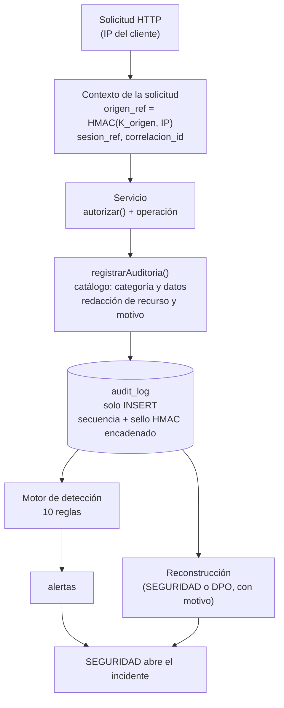
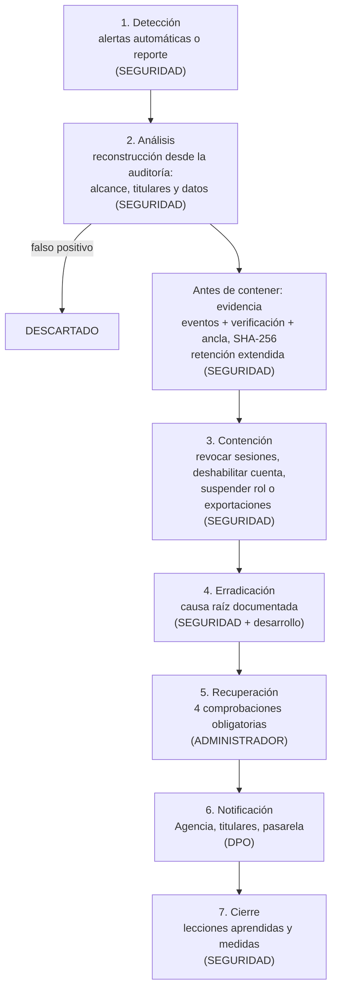
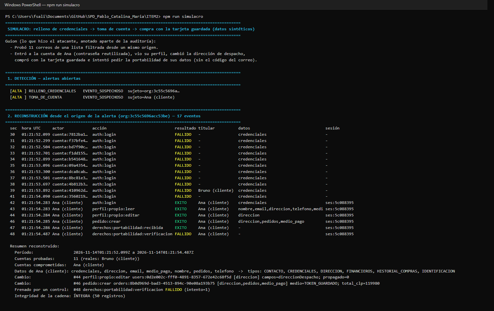
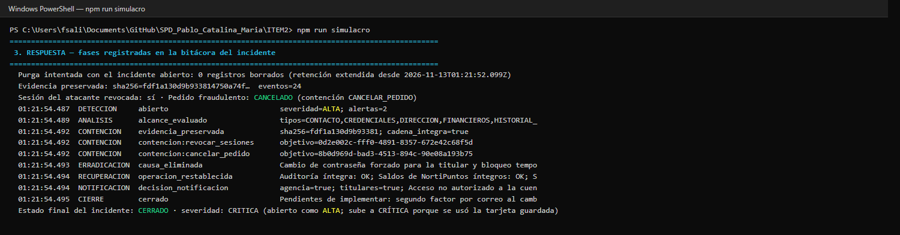
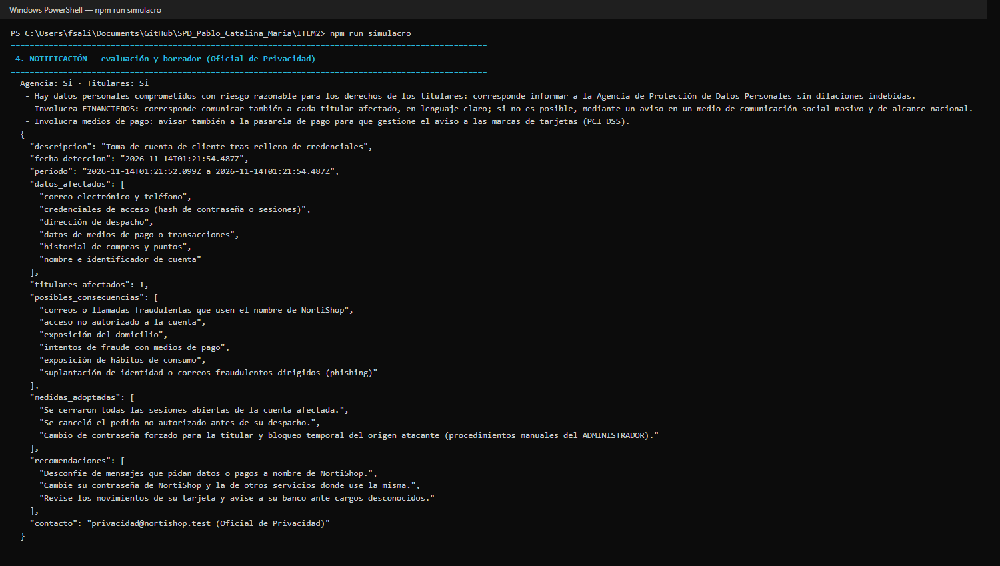
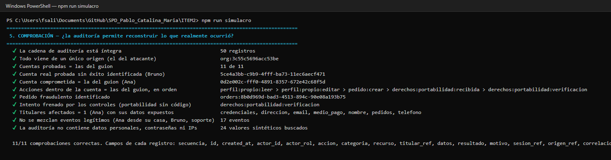
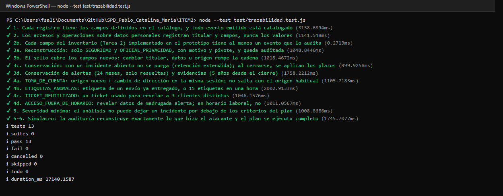

# Trazabilidad y plan de respuesta — NortiShop

**Caso 1:** Plataforma de comercio electrónico NortiShop
**Integrantes:** María Gerónimo · Pablo Lineros · Catalina Toledo · Fabián Salinas

## Introducción

Este informe muestra cómo NortiShop deja rastro de cada acceso y operación sobre datos personales, cómo protege esos registros, qué accesos anómalos detecta y cómo responde ante un incidente. Parte del inventario de datos y de los controles de las actividades anteriores (cifrado por campo, RBAC, auditoría sellada, consentimiento y derechos). Todo está implementado en el prototipo (`ITEM2/`) y en el script `06_trazabilidad.sql`, se comprueba con pruebas automatizadas y se demuestra con un simulacro de incidente (`npm run simulacro`). Se usan solo datos sintéticos.

## Eventos auditados y campos del registro

Qué se audita está definido en un catálogo (`src/security/catalogoAuditoria.js`) con 37 entradas más las denegaciones. Cada entrada indica la categoría, los nombres de los campos personales que toca y el nivel de exposición (completo, enmascarado o solo referencia). Un evento que no esté en el catálogo queda marcado como `NO_CATALOGADO`, y las pruebas fallan si aparece alguno.

Tabla: Eventos auditados por categoría

| Categoría | Eventos | Datos personales que toca |
|---|---|---|
| Autenticación | Inicio de sesión (exitoso o fallido), cierre de sesión, registro | Credenciales; en el registro, los datos de la cuenta |
| Acceso a datos | El titular ve su perfil, sus pedidos o su saldo de puntos; seguimiento de un pedido sin cuenta; soporte busca un cliente (enmascarado) | Nombre, correo, teléfono, dirección, medio de pago, pedidos, puntos |
| Acceso sensible | Soporte revela datos completos; logística genera una etiqueta; el DPO revierte un seudónimo o localiza los datos de un titular | Nombre, correo, teléfono, dirección |
| Modificación | El titular cambia su dirección o teléfono; rectificación ejecutada; publicación de una reseña | Los campos cambiados; la reseña |
| Transacción | Compra con cuenta (indica si se usó la tarjeta guardada) y sin cuenta; canje de NortiPuntos | Dirección, pedidos, medio de pago, puntos |
| Exportación | Copia de acceso o portabilidad; exportación de suscriptores | Copia completa; correo |
| Supresión, derechos, consentimiento y tratamiento | Supresión, solicitudes de derechos, cambios de consentimiento, encuesta de satisfacción | Según el caso |
| Control de acceso | Toda denegación: permiso que el rol no tiene, recurso ajeno o rol suspendido | Ninguno |
| Administración, procesos, seguridad y auditoría | Roles, catálogo, pedidos, envíos; ETL y plazos; alertas e incidentes; consulta, verificación, reconstrucción y purga de la auditoría | Ninguno |

*Fuente: elaboración propia.*

Tabla: Campos de cada registro de auditoría

| Campo | Contenido | Pregunta que responde |
|---|---|---|
| `secuencia`, `id`, `created_at` | Número consecutivo, identificador y fecha UTC | Cuándo |
| `actor_id`, `actor_rol` | Id interno y rol; si no inició sesión, un prefijo del índice ciego de la cuenta | Quién |
| `accion`, `categoria` | Acción y categoría del catálogo | Qué hizo |
| `recurso` | Tipo e id interno del objeto (`users:<id>`, `envio:<ref>`, `solicitud:<folio>`) | Sobre qué |
| `titular_ref` | Id interno del titular cuyos datos se tocaron | De quién son los datos |
| `datos` | Nombres de los campos (`nombre,direccion`), nunca sus valores | Qué datos |
| `resultado`, `motivo` | Permitido, denegado, éxito o fallido; ticket, causa o contadores, redactados | Con qué resultado y por qué |
| `sesion_ref` | Prefijo del SHA-256 del token de sesión | En qué sesión |
| `origen_ref` | HMAC de la IP con una llave propia; la IP no se guarda | Desde dónde |
| `correlacion_id` | Identificador aleatorio de la solicitud | Qué eventos produjo una misma solicitud |
| `hash_previo`, `hash` | Sello HMAC encadenado | Si alguien lo alteró |

*Fuente: elaboración propia a partir del modelo implementado.*

El catálogo parte del inventario de datos de la Tarea 2: cada campo personal del inventario tiene al menos un evento que registra quién lo vio o lo cambió (lo verifica una prueba automática).

Tabla: Campos del inventario de datos y eventos que los auditan

| Campo del inventario (Tarea 2) | Eventos que lo auditan |
|---|---|
| Nombre, correo, teléfono | Ver perfil, búsqueda y revelación por soporte, etiqueta (nombre), registro, rectificación |
| Contraseña | Inicio de sesión exitoso y fallido, registro |
| Dirección de despacho y comuna | Ver perfil, cambio de dirección, compra, etiqueta, revelación por soporte |
| Facturación (RUT, razón social, dirección) | Compra con factura, supresión (bloqueo legal) |
| Medio de pago guardado | Ver perfil, compra con la tarjeta guardada, retiro del consentimiento |
| Historial y estado de pedidos | Ver pedidos propios, gestión de pedidos, cambios de estado del envío, seguimiento sin cuenta |
| Saldo e historial de NortiPuntos | Consulta y canje de puntos; falla de integridad de la firma |
| Reseñas | Publicación (en la auditoría queda el titular interno; en la vista pública, solo el alias) |
| Datos del comprador invitado | Compra sin cuenta, etiqueta, seguimiento, anonimización al vencer el plazo |
| Correo de suscripción a marketing | Exportación de suscriptores, cambios de consentimiento, baja por enlace |
| Carrito de compras | No existe en el prototipo: no hay nada que auditar |

*Fuente: elaboración propia a partir del inventario de la Tarea 2 y del catálogo implementado.*

## Registro de accesos y operaciones

Cada solicitud abre un contexto con el origen seudonimizado, la sesión y un identificador de correlación. Así, todos los eventos que produce quedan ligados entre sí sin que cada servicio tenga que pasar esos datos.

<!-- img: ITEM2/evidencias/diagramas/D5_flujo_trazabilidad.png | Flujo de trazabilidad: de la solicitud al incidente -->

En esta etapa se agregaron a la auditoría operaciones que antes no dejaban rastro y que un atacante usaría:

- **Lectura del perfil y de los pedidos propios.** Un tercero que entra a la cuenta ve nombre, correo, teléfono y dirección.
- **Compras.** El motivo indica si se usó la tarjeta guardada (`medio=TOKEN_GUARDADO`) o una tarjeta de un solo uso.
- **NortiPuntos y reseñas.** La consulta y el canje de puntos, y la publicación de reseñas (en la auditoría queda el titular interno, que no aparece en la vista pública).
- **Registro, cierre de sesión, compras sin cuenta y su seguimiento.**
- **Inicio de sesión fallido contra una cuenta real.** Guarda el id interno de esa cuenta, para saber qué titulares reales fueron blanco.
- **Etiquetas de despacho.** Guardan el titular y el estado del envío.

Lo que nunca se guarda: valores de los datos personales, contraseñas, códigos de verificación, tokens de sesión o de pago, criptogramas e IPs. Los nuevos campos entran en el sello HMAC, así que alterar el titular, los datos o el origen de un registro rompe la cadena.

## Protección de los registros

Tabla: Quién puede hacer qué con los registros

| Operación | Quién | Control |
|---|---|---|
| Escribir | La aplicación (`svc_app`) | Solo `INSERT`; la secuencia y el sello los pone un disparador |
| Leer y filtrar | ADMINISTRADOR, OFICIAL_PRIVACIDAD, SEGURIDAD | Rol de BD `rol_auditor`; cada consulta queda auditada. ADMINISTRADOR solo lee: no reconstruye, no purga y no puede alterar sus propios registros |
| Reconstruir por titular, sesión u origen | SEGURIDAD y OFICIAL_PRIVACIDAD | Permiso `auditoria:reconstruir`, motivo obligatorio y al menos un pivote; queda auditada |
| Modificar | Nadie | Sin `UPDATE`; el sello encadenado y las anclas detectan cambios, borrados y truncamiento |
| Purgar | OFICIAL_PRIVACIDAD, con `svc_retencion` | Solo lo vencido, con constancia, y nunca si la cadena no está íntegra |

*Fuente: elaboración propia.*

Tabla: Plazos de conservación

| Registro | Plazo | Motivo |
|---|---|---|
| Auditoría (`audit_log`) | 24 meses | Investigar incidentes detectados tarde y responder reclamos sobre accesos pasados |
| Alertas | 24 meses, solo las resueltas | Mismo plazo que la auditoría de la que derivan |
| Evidencias de incidentes | 5 años desde el cierre | Rendición de cuentas ante la Agencia y posibles procesos sancionatorios |
| Anclas y constancias de purga | Indefinido | No tienen datos personales; permiten verificar la cadena tras cada purga |
| Logs de aplicación | 90 días | Solo diagnóstico técnico; ya vienen redactados |

*Fuente: elaboración propia.*

**Separación de funciones.** ADMINISTRADOR conserva la lectura porque atiende problemas de operación (accesos denegados, cambios de roles). Como sus propias acciones quedan en la misma auditoría, el control es que no puede modificarla ni purgarla, y que sus consultas quedan registradas (`auditoria:consulta`) para que SEGURIDAD las revise.

**Retención extendida.** Mientras haya un incidente abierto, la purga no borra nada posterior a 24 horas antes de su inicio, ni de la auditoría ni de los logs de aplicación. En el simulacro, una purga lanzada con el incidente abierto no borró ningún registro.

**Supresión y auditoría.** Cuando un titular pide la supresión (Informe 6), sus registros de auditoría no se borran: se conservan los 24 meses del plazo, porque son necesarios para la seguridad y la rendición de cuentas (prueban, entre otras cosas, que la supresión se atendió). Lo que queda son solo identificadores internos seudonimizados (`titular_ref`, `actor_id`, `origen_ref`) y nombres de campos, sin ningún valor. Además, una vez suprimida la cuenta, ese identificador ya no apunta a ningún dato en la base.

## Alertas de acceso anómalo

A las seis reglas genéricas que se implementaron junto con la auditoría sellada en el Hito 5 (`INFORME_CONSENTIMIENTO_DERECHOS_AUDITORIA.md`: fuerza bruta, relleno de credenciales, denegaciones repetidas, revelaciones masivas, exportaciones e integridad) se suman cuatro propias de NortiShop. Usan los nuevos campos (sesión, origen, titular y datos). El relleno de credenciales ahora se cuenta por origen, así que la alerta apunta al atacante.

Tabla: Alertas propias de NortiShop

| Alerta | Qué la dispara | Por qué en NortiShop | Severidad | Primera respuesta |
|---|---|---|---|---|
| `TOMA_DE_CUENTA` | Inicio de sesión de un cliente desde un origen nunca visto para su cuenta y, en esa misma sesión y dentro de 1 hora, cambio de dirección o teléfono, compra con la tarjeta guardada o pedido de copia de sus datos | Es el fraude típico del comercio electrónico: desviar un despacho pagado con la tarjeta guardada | Alta | Revocar sesiones, cancelar pedidos no despachados, forzar cambio de contraseña |
| `ETIQUETAS_ANOMALAS` | Etiqueta de un envío ya entregado o cancelado, o 15 o más etiquetas en 1 hora por un operador | La etiqueta es el único momento en que logística ve nombre y dirección | Media | Confirmar con despacho; si no hay explicación, deshabilitar la cuenta |
| `TICKET_REUTILIZADO` | Un mismo ticket se usa para revelar los datos de 3 o más clientes distintos en 24 horas | Revelar exige ticket y motivo; un ticket es un caso de un cliente | Alta | Contrastar con el ticket real; tratar como abuso interno |
| `ACCESO_FUERA_DE_HORARIO` | Personal revela datos, genera etiquetas, revierte seudónimos o exporta fuera de lunes a sábado de 08:00 a 21:00 (hora de Chile) | NortiShop no tiene turnos nocturnos ni dominicales | Media | Confirmar autorización; si no la hay, revocar sesiones |

*Fuente: elaboración propia.*

## Plan de respuesta a incidentes

El plan completo está en `PLAN_RESPUESTA_INCIDENTES.md`. Aquí se resumen sus criterios, responsables, fases y notificación.

**Criterios.** Una *alerta* es una señal aislada; un *evento sospechoso* es un patrón que exige análisis; un *incidente* solo lo declara SEGURIDAD. La severidad depende de los datos y del número de titulares: baja si no hay datos personales comprometidos; media con identificación o contacto de pocos titulares; alta con dirección, credenciales, abuso interno o más de 100 titulares; crítica con datos financieros (incluido el uso no autorizado de la tarjeta guardada), sensibles o de niños y niñas menores de 14 años, llaves comprometidas, integridad rota o más de 1.000 titulares. El sistema aplica estos criterios como severidad mínima: al registrar el análisis se puede subir la severidad, pero no dejarla por debajo de lo que exigen los datos y el número de titulares, y el ajuste queda en la bitácora. Se escala en menos de 1 hora (crítica), 4 horas (alta), en el turno (media) o en 24 horas (baja).

Tabla: Responsables

| Función | Rol en el sistema | Responsabilidad | Integrante |
|---|---|---|---|
| Líder del incidente | SEGURIDAD | Revisa alertas, abre el incidente, reconstruye, preserva evidencia, contiene (incluida la cancelación de pedidos no autorizados), erradica y cierra | Pablo Lineros |
| Oficial de privacidad (DPO) | OFICIAL_PRIVACIDAD | Evalúa el impacto en los titulares, decide y autoriza la notificación | Catalina Toledo |
| Administración | ADMINISTRADOR | Restablece la operación tras las comprobaciones | Fabián Salinas |
| Comunicación | — | Publica los comunicados aprobados por el DPO | María Gerónimo |

*Fuente: elaboración propia.*

La separación de funciones está en el código: SEGURIDAD contiene pero no restablece ni notifica; ADMINISTRADOR restablece pero no contiene; el DPO autoriza la notificación pero no ejecuta acciones técnicas.

**Fases.** El plan tiene siete fases: detección → análisis → contención → erradicación → recuperación → notificación → cierre (Figura 2). Antes de contener es obligatorio preservar la evidencia, y el sistema lo exige. La recuperación solo procede si pasan cuatro comprobaciones: la auditoría está íntegra, los saldos de NortiPuntos están íntegros, no hay alertas críticas abiertas sin revisar y la causa raíz está documentada.

<!-- img: ITEM2/evidencias/diagramas/D6_fases_respuesta.png | Fases del plan de respuesta y sus responsables -->

Tabla: Cuándo y a quién se notifica

| Destinatario | Cuándo | Plazo |
|---|---|---|
| Agencia de Protección de Datos Personales | Datos personales comprometidos con riesgo razonable para los titulares (Ley 21.719) | Sin dilaciones indebidas; meta interna de 72 horas desde la confirmación |
| Titulares afectados | Datos sensibles, de niños y niñas menores de 14 años, u obligaciones económicas, financieras, bancarias o comerciales (por ejemplo, uso de la tarjeta guardada); con credenciales, como buena práctica | Sin dilaciones indebidas, en lenguaje claro, a cada titular; si no es posible, aviso en un medio de comunicación social masivo y de alcance nacional |
| Pasarela de pago | Cualquier compromiso de tokens o transacciones (PCI DSS) | De inmediato, según contrato |

*Fuente: elaboración propia a partir de la Ley 21.719 y PCI DSS v4.0.*

**Contenido de la notificación.** El sistema genera un borrador con siete contenidos: descripción del incidente; fecha de detección y período; tipos de datos y número de titulares afectados; posibles consecuencias; medidas adoptadas (las acciones de contención y erradicación de la bitácora, que la ley exige registrar); recomendaciones según el tipo de dato (por ejemplo, "cambie su contraseña" o "revise los movimientos de su tarjeta"), y canal de contacto del DPO. La decisión de notificar o no queda registrada con su justificación, y el incidente no se puede cerrar sin ella.

## Simulacro de incidente

**Escenario.** Desde un único origen, un atacante prueba 11 correos de una lista filtrada en otro sitio. La contraseña de Ana estaba reutilizada, así que entra a su cuenta. Ve su perfil, cambia la dirección de despacho, compra con la tarjeta guardada e intenta pedir la portabilidad de sus datos. Mientras tanto, Ana, Bruno y soporte operan con normalidad. El guion anota por separado lo que hizo el atacante, para comparar después con lo que se reconstruye.

**Detección y reconstrucción.** Saltan `RELLENO_CREDENCIALES`, cuyo sujeto es el seudónimo del origen, y `TOMA_DE_CUENTA`, cuyo sujeto es Ana. SEGURIDAD reconstruye desde el origen de la primera alerta. Obtiene 17 eventos: 11 cuentas probadas (nueve inexistentes y dos reales: Bruno, sin éxito, y Ana, con éxito), la sesión con la que entró a la cuenta de Ana, los datos que vio, el cambio de dirección, la compra con la tarjeta guardada y el intento de portabilidad que frenó la verificación por código. La actividad legítima de Ana, Bruno y soporte no aparece.

*Fuente: captura de ejecución del sistema con datos sintéticos.*

**Respuesta.** El incidente se abre como de severidad alta. Con el resultado de la reconstrucción, SEGURIDAD registra el alcance: 1 titular; identificación, contacto, dirección, credenciales, financieros e historial. Como se usó la tarjeta guardada (datos financieros), el sistema eleva la severidad a **crítica**, según los criterios del plan, y lo deja en la bitácora. Luego preserva la evidencia (SHA-256), revoca las sesiones de Ana y cancela el pedido antes del despacho, ambas como acciones de contención registradas en la bitácora. Tras documentar la causa raíz (contraseña reutilizada y sin segundo factor ante un origen nuevo), el ADMINISTRADOR recupera la operación con las cuatro comprobaciones. El DPO concluye que corresponde notificar a la Agencia y a la titular, por tratarse de datos financieros, y avisar a la pasarela de pago. El borrador lista las medidas adoptadas: sesiones cerradas, pedido cancelado, cambio de contraseña forzado y bloqueo temporal del origen atacante (estas dos últimas, procedimientos manuales). El segundo factor ante un origen nuevo no se implementó: queda registrado en el cierre como medida preventiva pendiente.

*Fuente: captura de ejecución del sistema con datos sintéticos.*

*Fuente: captura de ejecución del sistema con datos sintéticos.*

**¿Los registros permiten reconstruir lo ocurrido?** Sí. Los 11 controles que comparan lo reconstruido con el guion son correctos.

Tabla: Comprobación de la reconstrucción contra el guion del atacante

| Comprobación | Resultado |
|---|---|
| La cadena de auditoría está íntegra | Correcto (50 registros) |
| Todo viene de un único origen, el del atacante | Correcto |
| Cuentas probadas = las del guion | 11 de 11 |
| Cuenta real probada sin éxito identificada | Bruno |
| Cuenta comprometida = la del guion | Ana |
| Acciones dentro de la cuenta, en orden | Ver perfil > cambiar dirección > comprar > pedir portabilidad > verificación fallida |
| Pedido fraudulento identificado | Con `medio=TOKEN_GUARDADO` |
| Intento frenado por un control | Portabilidad sin código del correo |
| Titulares afectados y sus datos | 1 (Ana): credenciales, dirección, correo, medio de pago, nombre, pedidos, teléfono |
| No se mezclan eventos legítimos | 17 eventos, todos del atacante |
| La auditoría no tiene datos personales, contraseñas ni IPs | 24 valores sintéticos buscados, ninguno encontrado |

*Fuente: elaboración propia a partir de la ejecución de `npm run simulacro`.*

*Fuente: captura de ejecución del sistema con datos sintéticos.*

## Pruebas

`npm test`: 106 pruebas aprobadas, 0 fallidas. De ellas, 13 son de esta actividad y están en `trazabilidad.test.js` (la Figura 7 muestra solo esas 13):

Tabla: Pruebas automatizadas por punto evaluado

| Punto | Prueba |
|---|---|
| 1. Eventos y campos | Los campos del catálogo coinciden con el esquema; un flujo que recorre casi todo el sistema no deja eventos sin catalogar; cada campo del inventario tiene un evento |
| 2. Registro sin los datos | Perfil, cambio de dirección, compra, etiqueta, revelación, rectificación, puntos y reseñas registran titular y campos; ningún valor, token ni IP queda en la auditoría |
| 3. Protección | Solo SEGURIDAD y DPO reconstruyen, con motivo y pivote; alterar titular, datos u origen rompe el sello; retención extendida con incidente abierto; plazos de alertas y evidencias |
| 4. Alertas | Las cuatro alertas propias saltan cuando corresponde y no saltan en el uso normal |
| 5. Criterios del plan | La severidad no puede quedar por debajo de la mínima según datos y titulares; se puede subir, no bajar |
| 5 y 6. Plan y simulacro | El simulacro completo: los 11 controles de la reconstrucción, la severidad crítica, las 7 fases, la notificación con sus siete contenidos y las medidas adoptadas, y el cierre |

*Fuente: elaboración propia.*

*Fuente: captura de ejecución del sistema con datos sintéticos.*

## Conclusión

La auditoría de NortiShop registra quién, qué, sobre qué titular, qué campos, cuándo y desde qué sesión y origen, sin guardar los datos. Eso basta para reconstruir un incidente real: en el simulacro se recuperó exactamente lo que hizo el atacante, se separó de la actividad legítima y se obtuvo el alcance para decidir la notificación. Quedan como limitaciones del prototipo que la base de datos, el correo y los terceros son simulados, que los orígenes conocidos de cada cuenta viven en memoria y que falta un segundo factor ante un origen nuevo, la principal medida preventiva que dejó el simulacro.
